<!-- ============================================================ -->
<!-- HERO: Monochrome ASCII Portrait (types in) beside            -->
<!-- Extruded 3D ASCII Wordmark (wipes in, then rocks on axis)    -->
<!-- (Or swap wordmark.svg with info-card.svg for Neofetch panel) -->
<!-- ============================================================ -->

<h3><code>sandesh@github ~ $ whoami</code></h3>

<table>
<tr>
<td valign="top"></td>
<td valign="top"></td>
<!-- To use the Neofetch Info Card instead, replace the line above with: -->
<!-- <td valign="top"></td> -->
</tr>
</table>

 
 

<!-- ============================================================ -->
<!-- ANIMATED CONTRIBUTION HEATMAP: Real live data scraped daily  -->
<!-- Diagonal staggered reveal with statistics footer             -->
<!-- Auto-refreshed daily by .github/workflows/update-profile-art.yml -->
<!-- ============================================================ -->

<h3><code>sandesh@github ~ $ ./contributions.sh</code></h3>

 
 

<!-- ============================================================ -->
<!-- PROFILE & CONNECTIVITY LINKS                                 -->
<!-- ============================================================ -->

<h3><code>sandesh@github ~ $ ./links.sh</code></h3>

<b>Full-Stack Developer · Python & Django · React & Mobile Engineer</b>

<i>Crafting scalable web architectures, cross-platform apps, and robust backend systems 📍 Nepal 🇳🇵</i>

 

